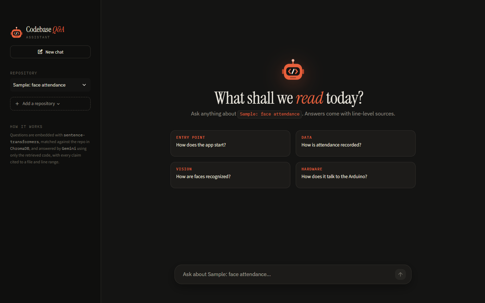
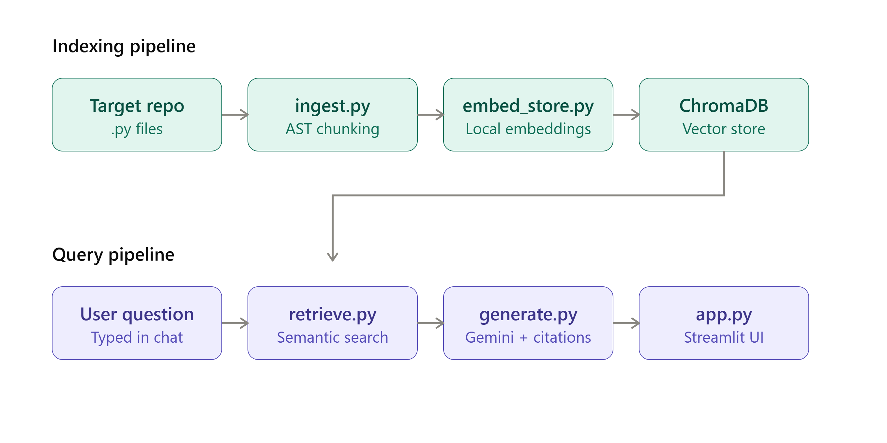

<p align="center"></p>

# CodeSage

CodeSage is a retrieval-augmented codebase assistant. Ask natural-language
questions about a Python repository and receive answers grounded in the
repository's actual source, with file and line citations for verification.

It is built as a practical RAG portfolio project: instead of asking an LLM to
guess how a project works, CodeSage parses the code, retrieves the most
relevant source sections, and tells the model to answer only from that
evidence.

## Why CodeSage?

Understanding an unfamiliar codebase takes time, especially when the answer
spans several modules. CodeSage lets developers ask questions such as:

- Where does execution start?
- How is a particular feature implemented?
- What happens when an operation fails?
- Which files participate in a workflow?

Every answer includes the source chunks used to generate it, so the result can
be checked directly against the code.

## Demo



Example question:

> What happens end-to-end when a known face is detected, from recognition to
> being logged?

The assistant can combine evidence from multiple files and cite locations such
as `simple_facerec.py:82-96` and `attendance.py:36-46`.

## Use CodeSage with a repository

1. Start the Streamlit app.
2. Select **Add a repository** in the sidebar.
3. Paste a public GitHub repository URL or upload a `.zip` file.
4. Wait for the repository to be parsed, embedded, and indexed.
5. Ask questions and inspect the cited source excerpts.

The app also includes a sample repository flow for trying the interface
without preparing a project first. Each indexed repository receives its own
ChromaDB collection, and the repository picker lets you switch between them.

## Architecture

CodeSage follows a five-stage RAG pipeline:

1. **Ingest** — `repo_loader.py` downloads a public GitHub repository or
   extracts an uploaded archive. Python files are parsed by `ingest.py`.
2. **Chunk** — the AST-based chunker extracts functions, classes, and module
   level code while preserving file paths and exact line ranges.
3. **Embed and store** — `embed_store.py` embeds each chunk locally with
   `sentence-transformers` and stores the vectors in persistent ChromaDB.
4. **Retrieve** — `retrieve.py` embeds the user's question and returns the
   most relevant chunks, optionally narrowing retrieval to a mentioned
   filename.
5. **Generate** — `generate.py` sends the question and retrieved context to
   Gemini with instructions to cite evidence and refuse to guess when the
   context is insufficient.

```text
GitHub link / .zip
        │
        ▼
repo_loader.py
(download and extract Python files)
        │
        ▼
ingest.py
(AST parsing and source chunking)
        │
        ▼
embed_store.py
(local embeddings and ChromaDB)
        │
        └──────────────────────────────┐
                                       ▼
User question ──► retrieve.py ──► relevant code chunks
                                       │
                                       ▼
                              generate.py + Gemini
                                       │
                                       ▼
                                app.py / Streamlit
```



## Tech stack

| Component | Technology | Purpose |
|---|---|---|
| Code parsing | Python `ast` | Structural code chunks with line metadata |
| Embeddings | `sentence-transformers` | Local semantic representations |
| Vector store | ChromaDB | Persistent local similarity search |
| Generation | Google Gemini API | Grounded explanations and citations |
| Interface | Streamlit | Chat UI and repository management |

## Evaluation

The evaluation harness in `eval.py` records retrieved sources and generated
answers for a manually reviewed question set. The current report contains 30
questions covering retrieval, configuration, routing, error handling,
unsupported features, and out-of-scope requests. See
[`eval_results.md`](eval_results.md) for every question, answer, source, and
grade.

The evaluation report is a test of CodeSage's retrieval and answer-grounding
behavior against a target repository; the target repository's own architecture
or technology choices should not be confused with CodeSage's implementation.

## Known limitations

- **Python source only.** The AST chunker currently indexes `.py` files.
- **Public GitHub links only.** Private repositories and non-GitHub links are
  not downloaded, although a project can be supplied as a `.zip` file.
- **Resource limits.** Downloads are capped at 50 MB, with limits on Python
  files and generated chunks to keep indexing predictable.
- **Local persistence.** ChromaDB data is stored locally. Hosted deployments
  may lose indexed repositories when their filesystem is reset.
- **API quotas.** Gemini free-tier limits can throttle requests; generation
  includes retry and backoff handling for transient failures.
- **Retrieval is not perfect.** Questions requiring facts outside the indexed
  source or poorly represented by the retrieved chunks may receive a
  cautious no-answer response.

## Setup

```bash
git clone <this-repo-url>
cd CodeSage

python -m venv venv
venv\Scripts\activate          # Windows
# source venv/bin/activate     # macOS/Linux

pip install -r requirements.txt
```

Create a `.env` file with a Gemini API key:

```text
GEMINI_API_KEY=your_key_here
```

Start the app:

```bash
streamlit run app.py
```

To build an index from a local target repository instead:

```bash
git clone <target-repo-url> target_repo
python ingest.py
python embed_store.py
```

## Project structure

```text
app.py                       Streamlit chat interface
repo_loader.py               GitHub and ZIP repository loading
ingest.py                    AST-based Python code chunking
embed_store.py               Embeddings and ChromaDB storage
retrieve.py                  Semantic code retrieval
generate.py                  Grounded Gemini responses
eval.py                      Evaluation harness
eval_results.md              Reviewed evaluation report
rag_pipeline_architecture.png
                             Pipeline diagram
```

